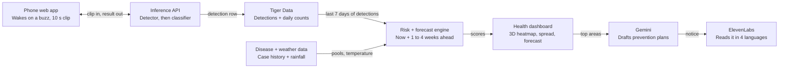

# Buzz Check — HackKnight 2026 Project Spec

Oct 9, 2026 · Raymond Wang

## Overview

Buzz Check is a Shazam for mosquitoes: a phone listens for the buzz, identifies the species, flags which diseases that species can carry, and feeds a heatmap that tells health workers where outbreaks are heading. Launch markets are Brazil (dengue) and Nigeria (malaria).

**The problem.** Mosquito surveillance needs traps, trained entomologists and labs. The countries with the heaviest mosquito-borne disease load have the least of all three, but high phone ownership.

**Why these two countries.**

- **Nigeria, malaria:** In 2024 malaria killed about 610,000 people worldwide. Nigeria alone carried 31.9% of malaria deaths in WHO's African Region, the highest anywhere ([World Malaria Report 2025 via ICIR](https://www.icirnigeria.org/?p=275865)).
- **Brazil, dengue:** Brazil recorded 6.48 million probable dengue cases and 5,972 deaths in 2024, a record year ([Ministry of Health via O Imparcial](https://oimparcial.com.br/noticias/2025/01/brasil-registra-em-2024-mais-de-64-milhoes-de-casos-de-dengue-mortes-somam-59-mil/)).
- The two diseases are spread by different mosquito genera, Anopheles and Aedes, which the Stanford Abuzz dataset covers and which sound different.

**Users.**

- **Everyday citizens** run a background listening app that wakes when it hears a mosquito, identifies it, and gives species-specific next steps.
- **Health departments and prevention organizations** see a 3D heatmap of detections, how disease risk is moving, forecasts days to weeks ahead, and Gemini-generated prevention recommendations.

**What it is not.** Buzz Check identifies a mosquito's species from sound and says which diseases that species can carry. It cannot tell whether a given mosquito is infected; lab testing still confirms that.

## Goals and success criteria

By Sunday 12:00 PM, a judge hears a buzz, watches the phone wake and name the species and its diseases, then sees the 3D heatmap in Lagos or São Paulo update.

**Goals**

- [ ] Listening mode that wakes on a mosquito buzz and uploads 10–15 s clips
- [ ] Species classifier trained on Abuzz, mapped to the diseases each species can carry
- [ ] Species-specific next steps on the phone (e.g. Anopheles → sleep under a treated net; Aedes → empty standing water, daytime repellent)
- [ ] Health dashboard: 3D heatmap (three.js), disease spread over time, a forecast days to weeks ahead
- [ ] Gemini prevention recommendations per area; ElevenLabs alerts in Portuguese, English, Yoruba or Hausa (pending voice support)
- [ ] Accuracy on a held-out set, with the number on a slide

**Non-goals this weekend**

- Detecting whether a mosquito is infected
- True background listening on iOS (see Component specs)
- Real deployments or partnerships in Brazil or Nigeria
- User accounts

**Stretch**

- Native Android build with real background listening
- One smart trap: Raspberry Pi + webcam microphone posting as a trap source

## System architecture

A recording travels phone → API → database in under 10 seconds; the risk engine turns those rows plus disease and weather data into a ranked list of where to act.

The risk engine is the part no competitor has; everything upstream exists in research, everything downstream is presentation.

## Component specs

Two products on one pipeline: a citizen listening app and a health dashboard, joined by the classifier API and Tiger Data.

### 1. Citizen app: Shazam for mosquitoes

**Listening mode.** A cheap always-on check runs on the phone, and the full model runs only when it fires.

- **Wake gate (on device):** analyze the mic in short frames, about 100 checks per second, looking for sustained energy in the mosquito wingbeat band (a few hundred hertz) and its harmonics. No network, no model, minimal battery.
- **Capture:** on a trigger, record 10 s at 8 kHz or higher. 10 s, not 15, because it is enough for the classifier, keeps uploads small on mobile data, and returns results faster.
- **Upload:** clip + coarse location (city district, not GPS) queued and sent when online; retries if the network drops.
- **Battery:** the radio and the model wake only on a trigger; the gate itself is a small FFT per frame.

**Platform reality.** A Next.js web app cannot listen in the background; phones stop the browser mic when the screen locks or the tab changes. For the demo, listening mode runs on screen. The real product is a native Android app using a foreground service with a visible notification (Android dominates in Nigeria and Brazil).

**Result screen.** Species (or genus when unsure), confidence, the diseases that species can carry, and species-specific next steps, with a play button for a spoken version.

| Species group | Can carry | Next steps shown |
| --- | --- | --- |
| Anopheles | Malaria | Sleep under an insecticide-treated net; seek a malaria test if fever follows |
| Aedes aegypti / albopictus | Dengue, Zika, chikungunya, yellow fever | Empty standing water today; daytime repellent; watch for fever and joint pain |
| Culex | Lymphatic filariasis, West Nile | Screens and nets at night; clear blocked drains |
| Unsure | — | "Couldn't identify. Try again closer to the sound." |

Gemini rewrites these into short, local-language advice, grounded on this table so it cannot invent guidance.

### 2. ML pipeline

1. **Preprocess:** resample to one rate, band-pass to the wingbeat range, log-mel spectrogram
2. **Detector:** mosquito vs. background, trained on HumBugDB's mosquito and non-mosquito audio
3. **Species classifier:** trained on the [Abuzz recordings](https://datadryad.org/dataset/doi:10.5061/dryad.98d7s) (20 species, phone-recorded); returns the top 3 species with probabilities
4. **Genus fallback:** if no species clears the threshold but a genus does, report the genus
5. **Disease likelihood:** each species maps to the diseases it is known to carry; the score shown is that species weight × local disease prevalence. It is a risk indicator, not the chance this mosquito is infected.
6. **Fallback:** a wingbeat-pitch rule so the demo works before the network is trained

Served from a Python FastAPI service: `POST /classify` takes audio + district, returns species, genus, confidence, diseases and detection id.

### 3. Data layer (Tiger Data)

- `detections` hypertable for every report
- Continuous aggregate of daily counts per district per species group
- `case_history` table of weekly disease cases per district, used for spread and forecasts

### 4. Risk and forecast engine

- **Now:** a transparent weighted score per district from recent detections, recent cases and rainfall/temperature
- **Forecast:** expected cases 1–4 weeks ahead per district from the recent case trend, seasonal baseline and detections; weather enters with a lag because mosquitoes take time to breed
- Every forecast shows a range, not a single number, and is labeled a prototype

### 5. Health dashboard

- **3D heatmap:** three.js columns over a city map (Lagos, São Paulo), height = detections, color = risk
- **Spread over time:** a time slider that animates detections and cases week by week
- **Forecast view:** each district's projected cases with its range
- **Recommendations:** Gemini drafts specific actions per district: larviciding sites, net distribution, community messaging, clinic alerts
- **Data uses panel:** what else this data supports (see below)

### 6. Alerts

Gemini drafts a public prevention notice per district; ElevenLabs reads it in Portuguese and English, plus Yoruba and Hausa if voice quality holds up.

### Other uses of the data

- Targeting bed-net and larvicide distribution
- Planning dengue vaccination campaigns by district
- Early warning for clinics to stock tests and fluids
- Parametric outbreak insurance and climate-health research
- Tracking invasive species spread, such as Aedes albopictus or Anopheles stephensi moving into new cities

## Data sources and schema

Species audio comes from Abuzz and HumBugDB; disease history and weather come from public sources for each country.

| Source | What we use | Access | Open question |
| --- | --- | --- | --- |
| [Abuzz (Stanford)](https://datadryad.org/dataset/doi:10.5061/dryad.98d7s) | Phone recordings of 20 species: 11 Anopheles, Aedes aegypti, Aedes albopictus, 3 Culex, others; 1.23 GB as .rar per species | Dryad download | Audio format and sample rate; license terms |
| [HumBugDB (Oxford)](https://arxiv.org/pdf/2110.07607) | ~15 h of non-mosquito background audio for the detector, plus more Anopheles | Zenodo, CC-BY-4.0 | Merge cleanly with Abuzz sample rates? |
| InfoDengue (Brazil) | Weekly dengue cases per municipality | Public API | Confirm endpoint and coverage for São Paulo |
| Malaria Atlas Project, WHO (Nigeria) | Modeled malaria incidence by area | Public downloads | Finest available geography and year |
| Open-Meteo | Daily rainfall and temperature | Free API, no key | — |
| geoBoundaries / GADM | District boundaries for both countries | Free downloads | Which admin level for the map |

**Species-to-disease table** (hand-built from public health references, stored in the API): species, genus, diseases carried, a weight per disease.

**`detections`** (Tiger Data hypertable, partitioned on `time`)

| Column | Type | Notes |
| --- | --- | --- |
| time | timestamptz | When recorded |
| detection_id | uuid | |
| country | text | BR or NG |
| district | text | Coarse location only |
| source | text | phone or trap |
| species | text | Top prediction, or null |
| genus | text | anopheles, aedes, culex, other |
| confidence | real | 0–1 |
| diseases | text[] | From the species table |
| model_version | text | |
| audio_url | text | Clip for review |
| is_simulated | boolean | True for seeded demo data |

**`daily_counts`**: continuous aggregate by day, district and genus.

**`case_history`**: week, district, disease, cases.

**`forecasts`**: district, disease, week ahead, low, mid, high.

## Tech stack, hosting and prizes

Next.js on Vercel talks to a FastAPI model service on a cloud host over HTTPS; a laptop copy behind a tunnel is the stage backup.

| Layer | Choice | Why |
| --- | --- | --- |
| Frontend | Next.js on Vercel | Raymond's lane; HTTPS by default, which phone browsers require for mic access |
| 3D heatmap | three.js (via React Three Fiber) over a map tile layer | 3D columns and a time-lapse animation |
| Audio | Web Audio API: wake gate + recording | No native code for the demo |
| Model service | Python FastAPI + PyTorch + librosa, in a Docker container | Same language as the model |
| Model hosting | Railway or Render (or Google Cloud Run with 1 minimum instance) | HTTPS URL in minutes; no cold start on stage |
| Proxy | Next.js API routes call FastAPI | Phone only talks to the Vercel domain; no CORS issues; API keys stay server-side |
| Database | Tiger Data cloud | Detections over time are its use case |
| LLM | Gemini API, called from Next.js API routes | Advice and prevention plans |
| Voice | ElevenLabs, called from Next.js API routes | Spoken alerts |
| Stage backup | Full stack on the demo laptop, exposed with a Cloudflare Tunnel or ngrok HTTPS link; phone on the laptop's hotspot | Works if venue Wi-Fi fails |

| Prize | How Buzz Check competes |
| --- | --- |
| Best Health Hack | Malaria and dengue prevention |
| Best Environmental Hack | Climate-driven disease spread, vector surveillance |
| Tiger Data | Detections, case history and forecasts as time series |
| Gemini API | Species advice and district prevention plans |
| ElevenLabs | Multilingual spoken alerts |
| GoDaddy domain | Register Saturday morning |
| Best Overall | Automatic entry |

## Competitive landscape

Others have proven phones can hear mosquitoes. Moving to Nigeria puts us in HumBug's home turf, so our edge must be the decision layer: species-to-disease risk, spread over time, forecasts and prevention plans for health workers.

| Product | What it does | Gap Buzz Check fills |
| --- | --- | --- |
| [HumBug / MozzWear](https://www.biology.ox.ac.uk/node/2892276) (Oxford) | Budget Android phones record mosquito flight tones, often with a modified bed net; malaria focus | Research tool for homes in Africa and Asia; no decision layer |
| [Abuzz](https://www.popsci.com/mosquitos-buzz-phone/) (Stanford) | Showed phones can ID 20 species by wingbeat, ~68% accuracy | Website for submissions, not a product |
| [Mosquito Alert, iNaturalist, GLOBE](https://www.wilsoncenter.org/article/using-citizen-science-and-ai-track-deadly-and-invasive-mosquitoes) | Photo-based citizen science with AI ID | Photographing a mosquito is hard; no audio |
| [VectorCam, Vectech](https://hub.jhu.edu/magazine/2025/spring/ai-entomologists-mosquito-malaria) | AI species ID from slides of caught mosquitoes | Needs a caught specimen; speeds up the lab, not collection |
| [Biogents BG-Counter](https://us-research-shop.biogents.com/products/bg-counter2-high-tech-mosquito-counting-device) | Smart trap that counts mosquitoes remotely | Fixed locations, costly per trap; limited species detail (to verify) |

**Positioning line:** "Oxford and Stanford proved a cheap phone can hear which mosquito is in the room. We turn those recordings into a live map of where malaria and dengue are heading, and what to do about it."

## Build timeline, roles and cut list

The whole plan hinges on tonight's audio test; if it fails by 2 AM, switch to direct clip upload and keep building.

| Phase | When | Work | Gate at the end |
| --- | --- | --- | --- |
| Validate | Fri 8 PM – 2 AM | Phone audio test, download data, repo + DB setup | Audio test passes (Sat 2 AM go/no-go) |
| Core build | Sat 9 AM – 2 PM | Model v1 trained, `/classify` API, recording app | |
| Integrate | Sat 2 PM – 9 PM | App to API to DB, map + risk score, seed demo data | Feature freeze (Sat 9 PM) |
| Polish | Sat 9 PM – 4 AM | Gemini + voice, domain + design, accuracy slide | |
| Ship | Sun 8 AM – 12 PM | Rehearse 3 times, backup video, Devpost submit | Submit on Devpost (Sun 12 PM) |

Each phase ends at a gate; nothing new starts after Saturday's 9 PM feature freeze.

**Cut list, first to go**

1. Smart trap
2. Forecast view (keep the current risk score)
3. Yoruba and Hausa alerts (keep Portuguese and English)
4. three.js 3D columns (ship the 2D heatmap)
5. Trained classifier (ship the pitch-rule fallback)

## Team plan

Three lanes joined by one API contract agreed by Friday 11 PM; Raymond builds against mock data until the model service is live.

| Person | Lane | Owns |
| --- | --- | --- |
| Pitch lead | Pitch and business | Deck, business plan, Devpost, demo script, Gemini prompts, voice scripts, Brazil/Nigeria research, domain |
| Raymond | Frontend, UI/UX and API | Next.js app, listening mode, result screen, three.js dashboard, Next.js API routes (proxy, Gemini, ElevenLabs, risk, detections, forecast) |
| Data/ML lead | Database and sound model | Datasets, preprocessing, detector, species classifier, FastAPI `/classify` service and hosting, Tiger Data schema, case data, risk and forecast engine, seed data |

### API contract (agree by Fri 11 PM)

| Endpoint (Next.js) | Backed by | Response |
| --- | --- | --- |
| `POST /api/classify` | FastAPI `/classify` | `detection_id`, `species`, `genus`, `confidence`, `diseases[]`, `is_mosquito` |
| `GET /api/risk?country=` | Tiger Data | per district: `risk_score`, `rank`, `detections_7d`, `cases_14d`, `weather_factor` |
| `GET /api/detections?country=&since=` | Tiger Data | recent detections for the map and time slider |
| `GET /api/forecast?district=` | Tiger Data `forecasts` | weeks 1–4: `low`, `mid`, `high` per disease |
| `POST /api/recommend` | Gemini | species advice or a district prevention plan |
| `POST /api/voice` | ElevenLabs | audio URL for a given text and language |

### Pitch lead

**Fri 9 PM – 1 AM**

- [ ] One-sentence problem and solution for Brazil and Nigeria; share by 11 PM
- [ ] Verify the headline stats (malaria deaths, Nigeria's share, Brazil's 2024 dengue figures) with source links
- [ ] Research who buys surveillance in each country: health ministries, state agencies, NGOs, malaria programs
- [ ] Register the domain

**Sat 9 AM – 2 PM**

- [ ] Business plan: buyer, pricing (per district license? grant-funded?), go-to-market through NGOs
- [ ] Gemini prompts: species advice (3 sentences, grounded on the species table) and district prevention plan
- [ ] Voice scripts; test ElevenLabs voices for Portuguese, English, Yoruba, Hausa and pick what sounds right
- [ ] Deck outline, 8 slides max

**Sat 2 PM – 9 PM**

- [ ] Build the deck with blank slots for accuracy and screenshots
- [ ] Competitor slide with the HumBug answer
- [ ] Devpost draft; judge Q&A answers

**Sat 9 PM – 2 AM**

- [ ] Insert real screenshots and the accuracy number
- [ ] First full rehearsal with the live demo, timed to 3 minutes

**Sun 8 AM – 12 PM**

- [ ] Two more rehearsals; record the backup video by 10 AM
- [ ] Submit on Devpost by 11:30 AM

### Raymond (frontend, UI/UX and API)

**Fri 9 PM – 2 AM**

- [ ] Audio test with Data/ML: speaker-played Abuzz clip into iOS Safari and Android Chrome, noise suppression off
- [ ] Write the API contract and the mock JSON files
- [ ] Next.js repo deployed to Vercel; visual direction and wireframes for listening, result and dashboard

**Sat 9 AM – 2 PM**

- [ ] Listening mode: wake gate (band energy check about 100 times a second), 10 s capture, upload queue
- [ ] Result screen: species, confidence, diseases, next steps, voice button, unsure state
- [ ] Next.js API routes on mocks: classify proxy, risk, detections, forecast, recommend, voice
- [ ] 2D heatmap of Lagos and São Paulo first (fallback if 3D slips)

**Sat 2 PM – 9 PM**

- [ ] Swap mocks for the live FastAPI service and Tiger Data
- [ ] three.js 3D columns over the map; time slider animation
- [ ] Forecast view; Gemini recommendations panel; ElevenLabs player
- [ ] Visible "simulated" labels on seeded data

**Sat 9 PM – 4 AM**

- [ ] Mobile polish on 2 phones; error states (mic denied, offline, timeout)
- [ ] Screenshots to the Pitch lead by 11 PM

**Sun 8 AM – 12 PM**

- [ ] Bug fixes only; run the full demo before each rehearsal

### Data/ML lead (database and sound model)

**Fri 9 PM – 2 AM**

- [ ] Audio test with Raymond; pass or fail by 1 AM
- [ ] Download Abuzz (Anopheles gambiae, arabiensis, stephensi, Aedes aegypti, albopictus, Culex quinquefasciatus first) and HumBugDB background audio
- [ ] Check formats, sample rates and clip counts per species
- [ ] Pitch-rule fallback in a FastAPI `/classify` deployed to Railway or Render
- [ ] Tiger Data tables: `detections`, `case_history`, `forecasts`

**Sat 9 AM – 2 PM**

- [ ] Preprocessing; split by recording session; noise augmentation from HumBugDB
- [ ] Train the detector and the species classifier; genus fallback
- [ ] Species-to-disease table; trained model live behind the confidence threshold

**Sat 2 PM – 9 PM**

- [ ] Load Brazil dengue case history and Nigeria malaria estimates; weather from Open-Meteo
- [ ] Risk score and 1–4 week forecast with ranges; back-test error on past weeks
- [ ] Seed simulated detections (`is_simulated = true`)
- [ ] Accuracy per genus and per species plus confusion matrix to the Pitch lead by 9 PM

**Sat 9 PM – 4 AM**

- [ ] Tune the threshold; load-test on venue Wi-Fi; laptop backup behind a Cloudflare Tunnel

**Sun 8 AM – 12 PM**

- [ ] Freeze the model; keep the service running

### Hand-offs

| When | From | To | What |
| --- | --- | --- | --- |
| Fri 11 PM | Raymond | All | API contract and mocks |
| Sat 1 AM | Raymond + Data/ML | All | Audio test pass/fail |
| Sat 9 AM | Data/ML | Raymond | Live `/classify` (fallback model) URL |
| Sat 2 PM | Pitch lead | Raymond | Gemini prompts and voice scripts |
| Sat 2 PM | Data/ML | Raymond | Tiger Data populated: detections, cases, forecasts |
| Sat 9 PM | Data/ML | Pitch lead | Accuracy and confusion matrix |
| Sat 11 PM | Raymond | Pitch lead | Screenshots |
| Sun 10 AM | Pitch lead | All | Backup video recorded |

## Demo script and judge prep

Three minutes: the phone wakes on a buzz, names the mosquito and its diseases, and the 3D map of Lagos changes.

1. **Hook (20 s):** "Malaria killed about 610,000 people last year, nearly a third of Africa's deaths in Nigeria. The places that need mosquito surveillance most have the fewest labs, but almost everyone has a phone."
2. **Wake (30 s):** the phone sits in listening mode; play an Abuzz Anopheles gambiae clip through the JBL speaker; the app wakes on its own.
3. **Result (25 s):** "Anopheles gambiae, malaria carrier" with confidence and next steps; tap play to hear it in Hausa or English.
4. **Dashboard (50 s):** the 3D heatmap over Lagos; scrub the time slider to show spread; open the forecast for one district.
5. **Recommendation (25 s):** Gemini's prevention plan for that district; switch to São Paulo and an Aedes clip to show dengue.
6. **Close (30 s):** accuracy number, competitors, what's next.

**Backup:** a recorded screen capture of the full flow.

**Questions judges will ask**

| Question | Our answer |
| --- | --- |
| How accurate is it? | Our held-out number per genus and per species, and where it fails |
| Does it detect infection? | No. It flags species that carry malaria or dengue; testing confirms infection |
| Can a web app listen in the background? | Not on phones. The demo runs on screen; the product is a native Android app |
| Isn't this HumBug? | HumBug detects mosquitoes; we add species-to-disease risk, spread maps, forecasts and prevention plans |
| What about battery and data costs? | An on-device wake gate; the model and upload run only on a trigger; 10 s clips |
| How good is the forecast? | A prototype with ranges, built on public case data; we show its error on past weeks |

## Risks and open decisions

The two build risks are the browser hearing the buzz at all and the scope of a 3D dashboard plus forecasts in one weekend.

| Risk | Impact | Mitigation |
| --- | --- | --- |
| Browser audio processing filters wingbeat frequencies | Wake gate never fires | Disable noise suppression; test iOS Safari and Android Chrome tonight |
| Wake gate false-triggers on fans, motors, voices | Floods uploads, drains battery | Require sustained band energy plus harmonics for ~1 s before capture |
| Abuzz clips differ from live phone audio | Accuracy drops on stage | Augment training with background noise from HumBugDB |
| Case data for Nigeria is coarse or modeled | Weak forecast for Lagos | Use Brazil (weekly municipal data) for the forecast demo; Nigeria for detection |
| three.js scope creep | Dashboard unfinished | Ship a 2D heatmap first; 3D columns on top only after Saturday 2 PM |
| Model service down or slow on venue Wi-Fi | Live demo fails | Laptop backup behind an HTTPS tunnel; recorded video |
| Map empty at demo time | Weak visual | Seed simulated detections, flagged `is_simulated` and labeled on screen |

**Open decisions**

- [ ] Clip length: 10 s (spec default) or 15 s?
- [ ] Map admin level for Lagos and São Paulo
- [ ] Forecast method: trend + seasonal baseline, or a small trained model?
- [ ] Which local languages ElevenLabs can voice well (Yoruba, Hausa)
- [ ] Smart trap: in or cut?

## Known weaknesses

The least proven claim is still that an everyday phone, left listening, can hear and identify a mosquito in a real home.

| Weakness | Why it matters | Response |
| --- | --- | --- |
| Real-room recording is hard | Mosquitoes are quiet; HumBugDB's detector dropped from strong to mediocre on noisy audio | Pitch the at-night, phone-on-the-nightstand use case, where the room is quiet and mosquitoes come close |
| Background listening is blocked in browsers | The "Shazam that runs in the background" claim cannot be demoed in a web app | Demo on-screen listening; show the native Android plan |
| Always-on microphone raises privacy fears | Users and regulators may distrust an app that listens all day | The wake gate runs on device; only triggered 10 s clips leave the phone; no speech is stored |
| Species accuracy will be modest | Abuzz reached about 68% across 20 species | Report genus accuracy (higher) and species accuracy separately |
| Sound cannot detect infection | A species can carry malaria without this mosquito being infected | Say "malaria-carrying species," never "infected" |
| HumBug already works in Africa on malaria | Judges may see us as a copy | Our product is the decision layer: disease risk, spread, forecasts, plans |
| Forecasts on thin data | Nigeria's case data is coarse; forecasts could mislead | Show ranges and back-tested error; label prototype |
| Reports skew toward phone owners | Poorest areas may look safest | Combine detections with case data; flag low-coverage districts |
| Data costs for users | Uploads cost money on prepaid plans | 10 s clips, compressed, uploaded on Wi-Fi when possible |
| Thin moat | Datasets are public; the formula is easy to copy | Defensibility comes from the detection network and health-ministry relationships |
